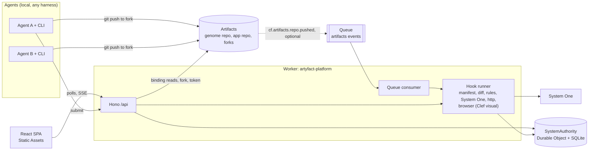

# artyfact

[](LICENSE)

A version control platform whose unit of change is the product model, not the file tree. Coding agents work in parallel forks against a typed model of the System, and the platform computes interference, checks and promotion over that model. It runs on Cloudflare Workers and Cloudflare Artifacts and was built for the Cloudflare "Build the Next-Gen Git Platform" competition.

- Website: https://artyfact.ing, with the agent guide at [/connect-agent](https://artyfact.ing/connect-agent), the theory at [/model](https://artyfact.ing/model) and a walkthrough drawn from Artyfact's own model at [/how-it-works](https://artyfact.ing/how-it-works).
- Hosted platform: https://artyfact-platform.dawka.workers.dev. It is a hosted demo: System One judgments, visual checks, intent translation and plan drafts are simulated, and its header says so. Run it on your own Cloudflare account for real judgments.
- Repository: https://github.com/sdawka/artyfact-cf
- npm package: `artyfact` (`npx artyfact@latest --help`)
- Licence: Apache-2.0

## How to use it today

Today the platform is driven by coding agents through the CLI and the `artyfact-genome` skill. The Genome is not authored in the browser yet. The web app is where a person looks and decides. The Map shows the model with candidates overlaid. Review accepts an imported Genome, agrees a proposed model change node by node, picks Task candidates and promotes. Changelog and Compare show what changed at System, Genome and file level. Deployments shows builds, deployments and runtime events. Authoring the Genome in the browser and a per-template UI are still under development.

The agent path, in order:

```sh
# 1. Install the skill into a project (Claude Code layout, or AGENTS.md for any other agent)
npx artyfact@latest skill --write --agent claude      # or --agent generic

# 2. The agent writes genome/**/node.yaml from the templates, then validates until the output ends in ok:
npx artyfact validate-genome ./genome --app .

# 3. Import: pushes the Genome and app to Artifacts and leaves an import review pending
ARTYFACT_ADMIN_TOKEN="$ADMIN_TOKEN" npx artyfact init --dir <project> --platform <origin>
```

A person then opens Review in the web app and accepts the import. From there the lifecycle runs from the CLI, with the admin token passed inline on coordinator commands only:

```sh
ARTYFACT_ADMIN_TOKEN="$ADMIN_TOKEN" npx artyfact evolution propose --system <id> --file intent.json
ARTYFACT_ADMIN_TOKEN="$ADMIN_TOKEN" npx artyfact plan draft --system <id> --evolution <evolution-id> --create
npx artyfact plan tasks <plan-id> --system <id>
ARTYFACT_ADMIN_TOKEN="$ADMIN_TOKEN" npx artyfact task claim <plan-id> <task-id> --system <id> --dir ./work/<task-id>
cd ./work/<task-id> && env -u ARTYFACT_ADMIN_TOKEN claude -p "Follow AGENTS.md and TASK_PACKET.md, then run npx artyfact task submit"
```

Inside the fork the agent runs `artyfact task checkpoint "<message>"` and `artyfact task submit`. The coordinator then runs `task select`, `plan integrate`, `plan review` and `plan promote`. Every command and flag is in [packages/cli/README.md](packages/cli/README.md); the skill the agent follows is [packages/cli/skills/artyfact-genome/SKILL.md](packages/cli/skills/artyfact-genome/SKILL.md). Claude Code can also load the skill as a plugin from the manifest in [.claude-plugin/](.claude-plugin/plugin.json) with `/plugin marketplace add sdawka/artyfact-cf` and then `/plugin install artyfact@artyfact`.

## Thesis

A file-centred platform can tell you that two agents changed different files. It cannot tell you that their changes disagree about what the product is. artyfact keeps a typed model of the System next to the code. The model is the Genome. It holds the purpose, the screens, the entities, the policies, the journeys and the criteria that say when each part counts as done.

A change starts as an Evolution of the Genome, reviewed from the purpose down to individual nodes. Implementation is a Realization: a plan of Tasks pinned to that revision, each with a scope of model nodes, a private fork and checks. The platform computes which Tasks interfere from the nodes they read and write, orders them into waves, integrates the selected candidates into one review, and promotes with a compare-and-swap on the reviewed System head. A verdict is `pass`, `fail`, `unknown`, `stale` or `waived`; only `pass` is drawn in the success colour.

## Judging criteria, where to look

- Originality. The unit of version control is the product model. The model and its loader are in `packages/model`, the Rule Packs and templates in `packages/templates`, the Datalog engine in `packages/rules`, and the ontology engine that routes an intent through the tree in `packages/ontology`. Design: [docs/design/model.md](docs/design/model.md) and [docs/design/ontology.md](docs/design/ontology.md). On screen: the Map, and the agreement tree under Work.
- Multi-agent concurrency. Task footprints and conflicts are computed in `apps/platform/worker/tasks/footprint.ts` and `planner.ts`, with no language model. Claims, leases, fencing and dependency refusal are in `apps/platform/worker/lifecycle-service.ts`. The compare-and-swap promote is in `apps/platform/worker/do/system-authority.ts`. Contracts: [docs/design/lifecycle.md](docs/design/lifecycle.md) and [docs/design/task-fork-model.md](docs/design/task-fork-model.md). On screen: the Work board with waves and conflict chips.
- User experience. The agreement tree in `apps/platform/src/views/work/intent/agreement`, one review across all Tasks in `apps/platform/src/views/review`, verdicts that are never green without a pass, and Changelog and Compare under `apps/platform/src/views`. The submission text is [docs/submission.md](docs/submission.md).

## How Cloudflare is used

One Worker serves everything. Static Assets serve the React single-page app. A Hono app handles `/api/*`, and the Worker also exports the queue handler and the Durable Object class.

**Artifacts.** The Genome and the app live in Artifacts repositories in one namespace, next to a shared `platform` repository of templates and Rule Packs. The Worker reads commits and trees through the `ARTIFACTS` binding and loads the Genome at an exact commit; no Git library runs in the Worker. Claiming a Task forks the app repository, commits the pinned Genome into the fork under `system/` over Git, and returns a short-lived write token and attempt secret. Resuming fences the previous attempt and replaces its credentials while preserving its fork. Agents clone and push with ordinary Git over HTTPS.

**Submission and push events on Queues.** The primary path is `artyfact task submit`, which pushes to the fork and then calls the API with the commit. The Worker also has a Queue consumer for Artifacts push events (`cf.artifacts.repo.pushed`) that resolves a fork to its realization and submits the new head. Artifacts emits push events only for a repository-level subscription, which is not created per fork automatically, so the consumer is wired and tested but is a deployed-only convenience. Both paths are idempotent on realization and commit.

**Durable Object with SQLite.** `SystemAuthority` is one Durable Object per System. It stores the head, System commits, Evolutions, plans, Tasks, candidates, evaluations and seen events. `promote` runs in one synchronous transaction: it compares the head with the caller's expected head, checks the promotion gate, writes a new System commit with a hashed manifest, moves the head and rejects sibling candidates. Promotion changes the manifest, not Git history.

**System One.** Semantic judgments go to System One. With `S1_PROVIDER` unset or `auto` the providers are tried in order: TypeSafe (`TYPESAFE_API_KEY`), Cloudflare Clef through the Workers AI binding (`AI`, `@cf/cloudflare/clef`), then OpenRouter (`OPENROUTER_API_KEY`). `S1_PROVIDER` set to `clef`, `jev`, `openrouter`, `fake` or `off` names one and never falls through; a named provider without its key or binding is off with the reason. `FAKE_S1=1` wins over all of it and is for local runs and tests. Without a provider every judgment is `unknown`. The hosted demo reads no model key; Clef and Jev run when you run Artyfact locally on your own account. Intent translation and plan drafting use OpenRouter, because Clef does not generate text.

**Visual checks.** A `browser` hook with `inputs.judgment: visual` captures the candidate's CI preview at 1280×800 and 390×844 through Cloudflare Browser Run, and reads screenshots the agent attached with `artyfact task submit --screenshot page.png`. Clef judges them when the `AI` binding is present, and the images are kept in the R2 bucket `artyfact-evidence`. Agent screenshots can fail a check but never pass it without a platform capture. A probability of 0.9 or above passes, 0.1 or below fails with a named concern, and anything between is `unknown`. Artyfact judges its own /model page this way.

**CI.** A separate `artyfact-ci` Worker runs a Workflow, started through a cross-script binding, that builds app commits in a container and deploys previews and production. The public site deploys from the Artifacts repo `artyfact/platform.builds` through the same Worker.

The longer version is in [docs/architecture.md](docs/architecture.md).

## Architecture



## What is deterministic and what is model-judged

The Genome is loaded and validated by a Datalog engine running versioned Rule Packs. The same Genome and the same packs give the same findings, and each finding carries its derivation. File mapping, scope checks, Task footprints, overlap detection, wave ordering and the promotion gate are plain code.

System One is asked only questions that need judgment: is a change a deliberate non-standard choice or a violation, does an edit contradict a stated commitment, would two changes interfere. Its answers are probabilities. At 0.9 or above they count as confident, between 0.5 and 0.9 they are labelled "review", and low confidence never produces a pass. The admin decides. Checks sit on three layers: the model holds together, the code realizes the pinned nodes, the running thing behaves. A blocking criterion with no completed evaluation is `unknown`, and `unknown` blocks, except for an outcome hook that only runs after deployment.

Without a System One provider, set `FAKE_S1=1` or the purpose gate stays `unknown` and promotion stays closed. The UI labels judgments from the fake provider. `.dev.vars.example` sets `FAKE_S1=1`, and it takes precedence over real keys until you remove that line.

## The model in two paragraphs

A System has a Purpose, a set of Externals (the people, devices and services outside it), one or more Things and a Theory of how the System should produce its outcome. The Genome is the intended model: a General Description, then nested ontologies for the System and each Thing, refined into requirements and criteria. The Proteome is the layer of agents and execution arrangements that realize the Genome. The Phenome is the layer of measurements and evidence. The three are views over the same nodes, so selecting `screen.people` keeps its identity when you switch layers.

An Evolution changes only the Genome. Its acceptance and implementation approval are distinct decisions. A Realization pins an accepted Genome revision and contains Tasks, each with scope, dependencies, steps and agent attempts. Task candidates integrate by artifact binding into one reviewed implementation manifest. A Task may change the pinned model under `system/` when it cannot be realized as written; the difference is submitted as a model delta, judged by System One and accepted at promotion. Criteria and their assay hooks supply evaluations with explicit methods, verdicts and limitations.

## The agent loop

The coordinator is whoever plans the work and hands out Tasks. `plan tasks` prints each Task with its wave, dependencies and footprint, and the next claim command. `task claim` forks the app repository, clones it, writes `TASK_PACKET.md` and an `AGENTS.md` block beside the code, and stores the fork token and attempt secret in `.git/artyfact-task.json`, never printed. The agent runs without the admin token, checkpoints and submits. Submit pushes the fork and submits that exact commit as a candidate; the platform maps the changed files to model nodes and runs the checks. A dependent Task is refused until its predecessors are selected, and so is a Task whose conflicting neighbour holds a live lease. The coordinator selects, integrates, reviews the whole implementation and promotes. See the [agent guide](https://artyfact.ing/connect-agent), [CLI commands](packages/cli/README.md) and [lifecycle contract](docs/design/lifecycle.md).

## Earlier flows still readable

The screenshots in [docs/images/](docs/images/) predate the plan flow. [map-candidates.png](docs/images/map-candidates.png) and [work-conflict.png](docs/images/work-conflict.png) show the older agent-level Realization views, and the two amendment screenshots show the older amendment review. Those flows remain readable in Work and Changelog, and their recorded commands are in [docs/demo-runbook.md](docs/demo-runbook.md).

## Run it locally

### Prerequisites

- Node 24 (`.nvmrc`) and pnpm, pinned by `packageManager` in `package.json` (`corepack enable` installs it). The repo is one pnpm workspace: run `pnpm install` once at the root.
- A Playwright browser for the end-to-end suites: `pnpm --filter @artyfact/platform exec playwright install chromium`.
- For the real backend only: a Cloudflare account on Workers Paid (Artifacts is unavailable on Free), `pnpm exec wrangler login`, and the Cloudflare `cf` CLI logged in with `cf auth login`. They log in separately; `pnpm exec wrangler whoami` and `cf auth whoami` must show the same account, and `artyfact init` and `pnpm run release` check this.
- Cost. Fixture and fake mode are free and talk to no Cloudflare service. The real backend uses Artifacts, which has a free tier of operations, plus Workers AI (`AI`, for Clef) and Browser Run (`BROWSER`, for preview screenshots), both billed to the logged-in account. [docs/costs.md](docs/costs.md) has the numbers.

### Three ways to run, cheapest first

**Fixture mode** needs no backend and no login. The SPA uses a bundled copy of the Peopling System. The same fallback appears whenever the API is unreachable, with a "fixture data" notice in the header.

```sh
pnpm test                                         # unit tests; the live System One smoke test is skipped without a key
pnpm run typecheck
pnpm run e2e                                      # builds the SPA and runs the Playwright suite on port 1338
pnpm --filter @artyfact/platform preview:fixture   # http://localhost:1338
```

**Fake platform** runs the whole backend on in-memory Artifacts seeded from `examples/`, with the fake System One and no AI or Browser Run. It needs no login and keeps no state between runs. The variables go in the shell, not in `.dev.vars`, because the Vite config reads them to drop the remote binding.

```sh
FAKE_ARTIFACTS=1 pnpm --filter @artyfact/platform dev                 # http://localhost:1337, Peopling imported
FAKE_ARTIFACTS=1 FAKE_SEED=both pnpm --filter @artyfact/platform dev  # also Artyfact's own genome/
pnpm --filter @artyfact/platform e2e:fake                             # use-case specs on port 1339 (self-model on 1340)
```

`FAKE_SEED` is `peopling` (default), `artyfact` or `both`. `FAKE_MODEL_DELTA=1` also seeds Task candidates that change the pinned model, for the Review view. The admin token is `fake-admin-token` unless `ADMIN_TOKEN` is set in the shell. Driving it with the real CLI and a local git transport is in [the runbook](docs/demo-runbook.md#the-fake-platform).

**Real backend** uses the `ARTIFACTS` binding, which is remote even in development, plus `AI` and `BROWSER` on your account. `pnpm run dev` sets `HOSTED_DEMO=0`, so judgments are real.

```sh
cp apps/platform/.dev.vars.example apps/platform/.dev.vars   # set ADMIN_TOKEN=$(openssl rand -hex 32) and ACCOUNT_ID
pnpm --filter @artyfact/platform dev                            # http://localhost:1337 (Vite moves to the next free port)
```

`apps/platform/wrangler.jsonc` carries the maintainer's account values (`ACCOUNT_ID`, `PUBLIC_URL`, `WORKERS_SUBDOMAIN`, the Flagship `app_id`). `ACCOUNT_ID` in `.dev.vars` overrides the first locally; change the rest before deploying to your own account. Read routes are unauthenticated; admin routes (import, claim, accept, reject, promote) need `ADMIN_TOKEN`.

### Platform Worker variables

Set in: `.dev.vars` (local, git-ignored), `vars` in `wrangler.jsonc`, a deployed secret (`pnpm exec wrangler secret put` in `apps/platform`), or the shell that starts Vite.

| Variable | Needed for | Set in | Default | Meaning |
| --- | --- | --- | --- | --- |
| `ADMIN_TOKEN` | admin routes | `.dev.vars`, secret | unset: admin routes return 503 | Bearer for import, claim, accept, reject and promote. |
| `ACCOUNT_ID` | real backend | `.dev.vars` or vars | the maintainer's id | Builds fork remotes `https://<id>.artifacts.cloudflare.net/git/<ns>/<repo>.git`. |
| `ARTIFACTS_NAMESPACE` | always | vars | `artyfact` | Artifacts namespace of the deployment. |
| `PUBLIC_URL` | CI builds | vars | the hosted origin | Deployed origin, used in CI report URLs and app vars. Local pages use the request origin. |
| `WORKERS_SUBDOMAIN` | nothing in the Worker | vars | `dawka` | Recorded only; the CI Worker's own copy builds preview URLs. |
| `HOSTED_DEMO` | deployed demo | vars | `1`; `pnpm run dev` forces `0` | `1` simulates System One, visual checks, translation and plan drafts and reads no model key. |
| `S1_PROVIDER` | System One | `.dev.vars`, secret | `auto` | `auto` tries TypeSafe, then Clef, then OpenRouter; `clef`, `jev`, `openrouter`, `fake` or `off` pick one and never fall through. |
| `FAKE_S1` | gate without keys | `.dev.vars` only | `1` in the example | Answers from the fake provider; the UI labels those judgments fake. Never deployed. |
| `TYPESAFE_API_KEY` | Jev | `.dev.vars`, secret | unset | TypeSafe key; Jev model `jev-latest`. |
| `OPENROUTER_API_KEY` | OpenRouter, Jev, translator, planner | `.dev.vars`, secret | unset | OpenRouter key. |
| `OPENROUTER_MODEL` | OpenRouter | `.dev.vars`, secret | `perplexity/pplx-decider-v1.1-27b` | Decisions API model. |
| `CLEF_MODEL` | Clef | `.dev.vars`, secret | `@cf/cloudflare/clef` | Workers AI model; `@cf/cloudflare/clef-flash` is the 9B one. |
| `JEV_MODEL` | Jev | `.dev.vars`, secret | `jev-latest` or `typesafe/jev-1.13` | Overrides the Jev model. |
| `TRANSLATE` | intents, plans | `.dev.vars`, secret | on | `0` turns off the LLM intent translator and plan draft planner. |
| `OPENROUTER_TRANSLATE_MODEL`, `OPENROUTER_PLAN_MODEL` | intents, plans | `.dev.vars`, secret | provider default | Translator model, and planner model (falls back to the translator's). |
| `CI_REPORT_TOKEN` | CI | `.dev.vars`, secret | unset: no CI | Bearer the `artyfact-ci` Workflow sends with build reports; same value on both Workers. |
| `CF_API_TOKEN` | push events | `.dev.vars`, secret | unset | API token for per-fork Artifacts event subscriptions. |
| `EVENTS_QUEUE_ID` | push events | `.dev.vars`, secret | unset | Queue id of `artyfact-artifacts-events`; subscriptions are skipped without it, `CF_API_TOKEN` and `ACCOUNT_ID`. |
| `OPERATIONS_BINDINGS` | runtime operations | `.dev.vars`, secret | unset: unavailable | JSON map of System and binding ids to `{accountId, scriptName, environment, flagshipAppId?}`. |
| `OPERATIONS_API_TOKEN` | runtime operations | `.dev.vars`, secret | unset | Server-only token for metrics and Flagship management. |
| `VERIFICATION_URL` | cloud verification | `.dev.vars` | the example points at the maintainer's CI | `artyfact-ci` origin the local operator calls; unset returns 503. |
| `VERIFICATION_TOKEN` | cloud verification | `.dev.vars` | unset | Same value as the CI Worker's `VERIFICATION_TOKEN`. |
| `ALLOW_LOCAL_PREVIEW` | local previews | `.dev.vars` only | `1` in the example | Lets the health hook fetch `http://localhost` and `127.0.0.1` previews. Never deployed. |
| `PREVIEW_HOST_ALLOWLIST` | custom preview hosts | vars or `.dev.vars` | empty | Extra hosts, comma-separated; `*.workers.dev` and `*.pages.dev` are always allowed. |
| `FAKE_ARTIFACTS`, `FAKE_SEED`, `FAKE_MODEL_DELTA` | fake platform | shell | unset | See fake platform above. A build refuses `FAKE_ARTIFACTS=1`. |
| `ARTYFACT_PERSIST_STATE_DIR` | local state | shell | `.wrangler/state` | Where `pnpm run dev` keeps Durable Object state. |
| `ARTYFACT_E2E_PORT` | e2e | shell | 1338, or 1339 fake | Port for the Playwright suites when the default is taken. |

Bindings need no variable. `FLAGS` is the Flagship app that gates the `cat-mode` flag; absent or failing, every flag is off. `EVIDENCE` is the R2 bucket `artyfact-evidence`, `SYSTEMS` the Durable Object, `CI` the cross-script Workflow in `artyfact-ci`.

### CI Worker and site

`apps/ci` has its own configuration. Setup and the token scopes are in [apps/ci/README.md](apps/ci/README.md).

| Variable | Set in | Meaning |
| --- | --- | --- |
| `CI_REPORT_TOKEN` | secret | Same value as the platform's. |
| `CF_TOKEN` | secret | Workers Scripts Edit token (plus D1 Edit) used only by the deploy step. Never the platform's `CF_API_TOKEN`. |
| `R2_ACCESS_KEY_ID`, `R2_SECRET_ACCESS_KEY` | secret | R2 token for the `artyfact-ci-cache` bucket. |
| `VERIFICATION_TOKEN` | secret | Operator bearer for `/verify` and `/site-deploys`. |
| `PLATFORM_URL` | vars | Platform origin; reports elsewhere are refused. |
| `WORKERS_SUBDOMAIN`, `CLOUDFLARE_ACCOUNT_ID` | vars | Preview URLs, and the account for checkout and deploy. |
| `BACKUP_BUCKET_NAME` | vars | Equal to the R2 bucket name. |
| `D1_DATABASE_IDS`, `FLAGSHIP_APP_IDS` | vars (JSON) | Per System, the D1 ids and Flagship app ids an app may bind. |

The site (`apps/site`) has no runtime variables. Its build reads optional `SITE_PLATFORM_URL`, `SITE_PLATFORM_READY` and `SITE_SOURCE_URL` ([apps/site/README.md](apps/site/README.md)).

### CLI variables

| Variable | Meaning |
| --- | --- |
| `ARTYFACT_PLATFORM`, `ARTYFACT_URL` | Platform URL, after `--platform`. Without either the CLI probes ports 1337 to 1346 for a server that identifies as artyfact, and sends no credential otherwise. |
| `ARTYFACT_ADMIN_TOKEN` | Admin bearer. Pass it inline per command; never export it. |
| `ARTYFACT_TOKEN`, `ARTYFACT_SECRET` | A Task's fork write token and attempt secret; override the copies saved in the workspace. |
| `ARTYFACT_SYSTEM`, `ARTYFACT_EVOLUTION` | Defaults for `--system` and `--evolution`. |
| `ARTYFACT_ALLOW_REMOTE_HOST` | One extra git host allowed for local dev, such as the fake platform's. |
| `ARTIFACTS_NAMESPACE`, `ARTYFACT_NAMESPACE` | Namespace for `init` and `platform-sync`, and for `release` and `operator`; default `artyfact`. |
| `CLOUDFLARE_ACCOUNT_ID` | Picks the account when Wrangler and `cf` see several. |

### Import a project

`npx artyfact init --dir <project>` takes a cloned project from its Genome (`genome/node.yaml`) to an imported System in one command; `scripts/bootstrap.sh` runs it on the Peopling example. It needs the real backend and `ARTYFACT_ADMIN_TOKEN`; without the token it prints the `curl` line and exits 0. The import stays pending until a person accepts it in Review, unless `--no-review` is passed. One Artifacts namespace per deployment: `system.peopling` gives the repositories `peopling.genome` and `peopling.app`, Task forks are `<repo>--task-<id>` with the pinned Genome under `system/`, and integration forks are `<repo>--integrate-<id>`. The `platform` repository holds the templates and Rule Packs; `init` creates it when missing and `npx artyfact platform-sync` updates it. `init` never rewrites history, never pushes secret files, `node_modules`, `.wrangler` or `dist`, and a re-run is a no-op. `--from-template template.thing.<id>@<version>` seeds a new app from a scaffold. The full loop against real Artifacts, with agents, waves, a refused dependent Task and a promotion, is [docs/demo-runbook.md](docs/demo-runbook.md).

### Deploy and release

`pnpm run release`, from a clean checkout of main, builds the platform and the site, commits them with a `release.json` to the Artifacts repo `artyfact/platform.builds` and deploys the platform Worker from that checkout ([design](docs/design/release-artifacts.md)). A push to that repo also starts the site deploy Workflow in `artyfact-ci`. `pnpm run deploy` is the manual fallback. Resources, first deploy and the production admin token are in [docs/deploy.md](docs/deploy.md).

## Artyfact describes itself

The repo-root `genome/` is Artyfact's own Genome (`system.artyfact`, on the dev-platform template): ten Things (platform, ci, site, model, ontology, semantic, rules, templates, cli and effects), with their real endpoints, commands, Durable Objects, Workflow and bindings, `dependsOn` links that match the workspace dependencies, and node `files` that cover every source file outside `.artyfactignore`. `packages/templates/test/self-genome.test.ts` checks all of that, and the site's /how-it-works page is drawn from it at build time. To browse it on the fake platform, with no login:

```sh
cd apps/platform
FAKE_ARTIFACTS=1 FAKE_SEED=artyfact pnpm exec vite --port 1337   # FAKE_SEED=both imports Peopling too
```

A deployed app reports what it observes to `POST /api/systems/:id/phenome/events`; the header schema is `PhenomeEventHeader` in `packages/model/src/phenome.ts`, and the Deployments view groups the events by build. Runtime metrics and Flagship controls need `OPERATIONS_BINDINGS` and `OPERATIONS_API_TOKEN`; without them the view reports the data as unavailable.

## Repository layout

| Path | What it holds |
|---|---|
| `packages/model` | Schemas, loader, validation, diff, overlap |
| `packages/rules` | Datalog engine with derivation trees |
| `packages/templates` | System and Thing templates, Rule Packs |
| `packages/ontology` | Ontology engine, intent routing, System One providers |
| `packages/semantic` | System One client, question catalog, policy |
| `packages/cli` | The `artyfact` command and the `artyfact-genome` skill |
| `apps/platform` | The Worker, the Durable Object and the SPA |
| `apps/ci` | The `artyfact-ci` Worker: build Workflow, previews, site deploys |
| `apps/site` | The public site at artyfact.ing |
| `genome` | Artyfact's own Genome (node tree) |
| `examples/peopling-system` | The worked example Genome |
| `examples/peopling-app` | The example app that agents change |
| `docs/design` | Design notes for each part |
| `docs/costs.md` | Cloudflare cost plan, usage checks and guardrails |

## Not done on purpose

- Authoring the Genome in the browser and a per-template UI. Agents author through the CLI and skill today.
- The Ascent and WASM evaluator.
- Reasoning-model hooks beyond System One.
- Paid runs.
- A Git-parity suite. Artifacts is used for what a Git platform needs here, and nothing more is claimed.
- Platform-hosted agents. Agents run on the user's machine.
- Replay of server-sent events after a disconnect. The UI polls and refetches on reconnect.
- Authentication beyond one admin bearer token and per-Task secrets. Claiming needs the admin bearer; checkpoint, submit and status need the attempt secret returned once at claim, or the admin bearer. The platform keeps only the secret's hash. There are no user accounts.

## Licence

Apache-2.0. See [LICENSE](LICENSE) and [THIRD_PARTY_NOTICES.md](THIRD_PARTY_NOTICES.md).
