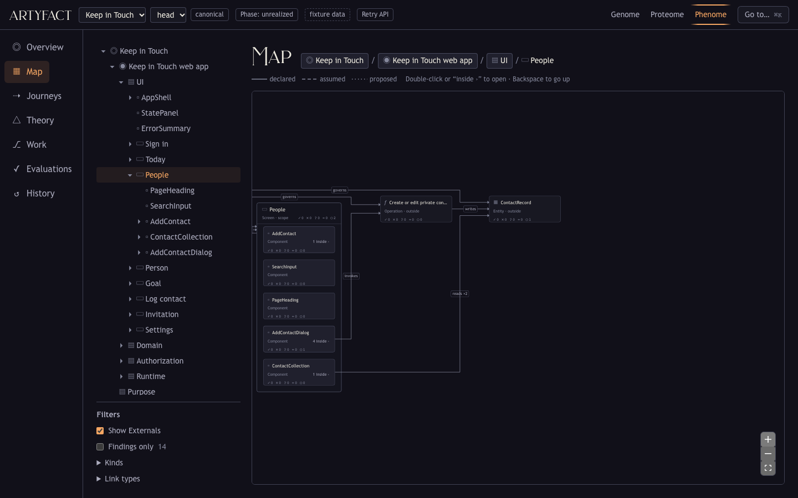
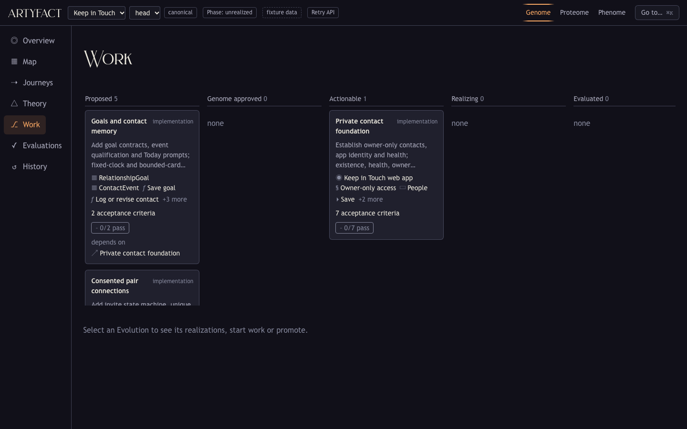
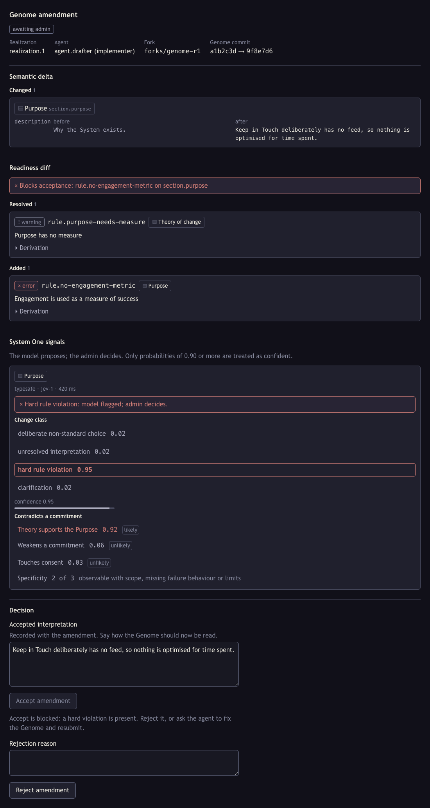
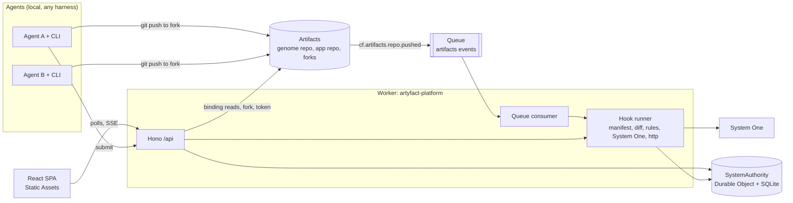

# artyfact

[](LICENSE)

A collaboration platform whose main object is the whole System, not a repository. It runs on Cloudflare Workers and Cloudflare Artifacts. It was built for the Cloudflare "Build the Next-Gen Git Platform" competition.

## Thesis

A file-centred platform can tell you that two agents changed different files. It cannot tell you that their changes disagree about what the product is. artyfact keeps a typed model of the System next to the code. The model is the Genome. It holds the purpose, the screens, the entities, the policies, the journeys and the criteria that say when each part counts as done.

Agents work in a loop. The platform hands an agent a task packet cut from the Genome and a private fork of the repository with a scoped token. The agent pushes. The platform maps the changed files back to Genome nodes, runs the hooks bound to the affected criteria, and compares the new candidate with every other candidate in flight. A person reviews the result and promotes one candidate. Promotion is a compare-and-swap on the System head, so a candidate built on an old head is refused with a 409. Nothing is green without evidence. A verdict is `pass`, `fail`, `unknown`, `stale` or `waived`, and only `pass` is ever drawn in the success colour.

## See it in 90 seconds

Hosted demo: https://artyfact-platform.dawka.workers.dev. Until a System is imported it shows a fixture-mode banner and the bundled example. Deployment steps are in [docs/deploy.md](docs/deploy.md).



The Map shows `screen.people`, its parts, and the Externals and operations it touches. The layer switch swaps Genome, Proteome and Phenome over the same nodes. With candidates on, a bracket halo marks nodes a candidate touches and a double bracket marks nodes two candidates share.



The Work board groups Evolutions by state. Starting work on an Evolution forks the repository, issues a token and shows the task packet and the CLI line. When two candidates overlap in meaning, the conflict shows here even if their files do not overlap.




The amendment review separates a deliberate non-standard choice from a rule violation. The two screenshots come from the fixture page described below. The screenshots above were taken in fixture mode, so they show no live candidates yet. See `docs/images/` and the notes in `docs/video-script.md` for what is retaken live.

More views: [Journeys](docs/images/journeys-connect.png), [Theory](docs/images/theory.png), [Overview](docs/images/overview.png).

## How Cloudflare is used

One Worker serves everything. Static Assets serve the React single-page app. A Hono app handles `/api/*`, and the Worker also exports the queue handler and the Durable Object class.

**Artifacts.** The Genome and the app live in Artifacts repositories in one namespace. The Worker reads them through the `ARTIFACTS` binding: it reads commits and trees, walks them, and loads the Genome at an exact commit. No Git library runs in the Worker. Starting a realization forks the app repository (or the Genome repository for an amendment), waits for the fork to be ready, and issues a write token that expires after six hours. The token is returned once, in the response to the start-work call. Agents clone and push with ordinary Git over HTTPS.

**Push events on Queues.** Artifacts push events (`cf.artifacts.repo.pushed`) arrive on a Queue. The consumer resolves the fork to its realization and submits the new head. The CLI `submit` command does the same over HTTP. Both paths are idempotent on realization and commit, and the event id is recorded so a redelivered event does nothing.

**Durable Object with SQLite.** `SystemAuthority` is one Durable Object per System. It stores the head, System commits, Evolutions, realizations, candidates, evaluations and seen events. `promote` runs in one synchronous transaction. It reads the head, compares it with the caller's expected head, checks the promotion gate, writes a new System commit with a hashed manifest, moves the head and rejects sibling candidates. Promotion changes the manifest, not Git history.

**Storage.** The System's state lives in two places: the Artifacts repositories and the Durable Object's SQLite. Evaluations and their observations are stored in the Durable Object.

**System One.** Semantic judgments, such as classifying a Genome change, go to System One through TypeSafe, or through OpenRouter if only that key is set. The key is a Worker secret. Without a provider every judgment is `unknown`. See the run notes for `FAKE_S1`.

The longer version, with a diagram, is in [docs/architecture.md](docs/architecture.md).

## Architecture



## What is deterministic and what is model-judged

The Genome is loaded and validated by a Datalog engine running versioned Rule Packs. The same Genome and the same packs give the same findings, and each finding carries its derivation. File mapping, scope checks, existence checks, overlap detection and the promotion gate are plain code.

System One is asked only questions that need judgment: is a change a deliberate non-standard choice or a violation, does an edit contradict a stated commitment, would two changes interfere. Its answers are probabilities. At 0.9 or above they count as confident, between 0.5 and 0.9 they are labelled "review", and low confidence never produces a pass. The admin decides. Promotion blocks on hard criteria that have a bound hook, and an Evolution's acceptance criteria are always in the gate pool. Those that are hard and have a bound hook block. A blocking criterion with no completed evaluation is `unknown`, and `unknown` blocks.

Without a System One provider (`TYPESAFE_API_KEY` or `OPENROUTER_API_KEY`), set `FAKE_S1=1` or the purpose gate stays `unknown` and promotion stays closed. The UI labels judgments from the fake provider. `.dev.vars.example` sets `FAKE_S1=1`, and it takes precedence over real keys. A local run copied from the example therefore uses the fake provider until you remove that line.

## The model in two paragraphs

A System has a Purpose, a set of Externals (the people, devices and services outside it), one or more Things and a Theory of how the System should produce its outcome. The Genome is the intended model: a General Description, then nested ontologies for the System and each Thing, refined into requirements and criteria. The Proteome is the layer of agents and execution arrangements that realize the Genome. The Phenome is the layer of measurements and evidence. The three are views over the same nodes, so selecting `screen.people` keeps its identity when you switch layers.

Change goes through Evolutions, Realizations and Evaluations. An Evolution is an intended change with affected nodes and acceptance criteria. A Realization is one agent's attempt at it, in a fork, ending in a candidate manifest. A Criterion belongs to an owner and is attached to a subject. An Assay hook binds a criterion to something that can check it. An Evaluation records the question, the method, the observations, the verdict and the limits. Promotion records the selected candidates and the rationale in a System commit. A realization cannot promote a Genome amendment by itself. A Genome amendment needs an admin decision.

## The agent loop

An agent (or its operator) starts work on an Evolution. The platform forks, issues a token and returns a task packet: intent, acceptance criteria, Genome excerpts for the affected nodes, commitments, permitted and protected paths, entry files, commands and the list of concurrent work. The CLI clones the fork, writes the packet and an `AGENTS.md` block, and the agent works, checkpointing as it goes. On submit the platform records a candidate, runs the hooks for the affected criteria, and reports overlap with the other candidates. A person selects a candidate and promotes it, or rejects it.

## The two moments

**Two agents, different files, one conflict.** Two agents work on different Evolutions. Their changed files do not overlap. Both touch nodes that serve the same journey and policy, and the platform reports a soft-semantic conflict between the candidates. The reviewer sees it on the Work board before promotion. Details and commands: `TODO(runbook)`.

**A deliberate choice is not a rule violation.** An agent amends the Genome. One amendment makes a coherent product decision that no accepted rule forbids. Another contradicts a stated commitment. The review panel shows the first as a deliberate choice, with the model's probabilities as plain numbers, and the second as a flagged violation that blocks acceptance. The admin decides in both cases and records the interpretation. Details and commands: `TODO(runbook)`.

## Run it locally

No Cloudflare login is needed to try the interface. In fixture mode the SPA uses a bundled copy of the Keep in Touch System and nothing talks to Cloudflare.

```sh
npm install
npm test               # unit tests; the live System One smoke test is skipped without a key
npm run typecheck
npm run e2e            # builds the SPA and runs the Playwright suite
npm run preview:fixture -w @artyfact/platform
```

`npm run e2e` drives a real browser. If Playwright reports a missing browser, run `npx playwright install chromium` once.

The real backend needs a login, because the `ARTIFACTS` binding is remote even in development. Run `npx wrangler login` or set `CLOUDFLARE_API_TOKEN`. The same applies to deploying.

```sh
cp apps/platform/.dev.vars.example apps/platform/.dev.vars
npm run dev -w @artyfact/platform   # http://localhost:5173
```

The amendment review has its own fixture page and needs no login:

```sh
npm run dev:amendment -w @artyfact/platform
# http://localhost:5199/amendment-dev.html?scenario=deliberate|hard|review|fake|off|findings
```

Admin routes (import, accept, reject, promote) need `ADMIN_TOKEN`. The preview health probe reaches only `*.workers.dev`, `*.pages.dev`, hosts in `PREVIEW_HOST_ALLOWLIST`, or localhost when `ALLOW_LOCAL_PREVIEW=1`.

The full loop against real Artifacts, with two agents and a promotion, is in `docs/demo-runbook.md` (`TODO(runbook)`: link when it lands). Hosted deployment: [docs/deploy.md](docs/deploy.md).

## Repository layout

| Path | What it holds |
|---|---|
| `packages/model` | Schemas, loader, validation, diff, overlap |
| `packages/rules` | Datalog engine with derivation trees |
| `packages/templates` | System and Thing templates, Rule Packs |
| `packages/semantic` | System One client, question catalog, policy |
| `packages/cli` | The `artyfact` command for agents |
| `apps/platform` | The Worker, the Durable Object and the SPA |
| `examples/keep-in-touch-system` | The worked example Genome |
| `examples/keep-in-touch-app` | The example app that agents change |
| `docs/design` | Design notes for each part |

## Not done on purpose

- The Ascent and WASM evaluator.
- Reasoning-model hooks beyond System One.
- Paid runs.
- A Git-parity suite. Artifacts is used for what a Git platform needs here, and nothing more is claimed.
- Platform-hosted agents. Agents run on the user's machine.
- Replay of server-sent events after a disconnect. The UI polls and refetches on reconnect.
- Composing more than one app candidate or Genome candidate in one promotion. The API returns `invalid-state`.
- Authentication beyond one admin bearer token. Start work, checkpoint, submit and sync are unauthenticated in this version.

## Licence

Apache-2.0. See [LICENSE](LICENSE) and [THIRD_PARTY_NOTICES.md](THIRD_PARTY_NOTICES.md).
