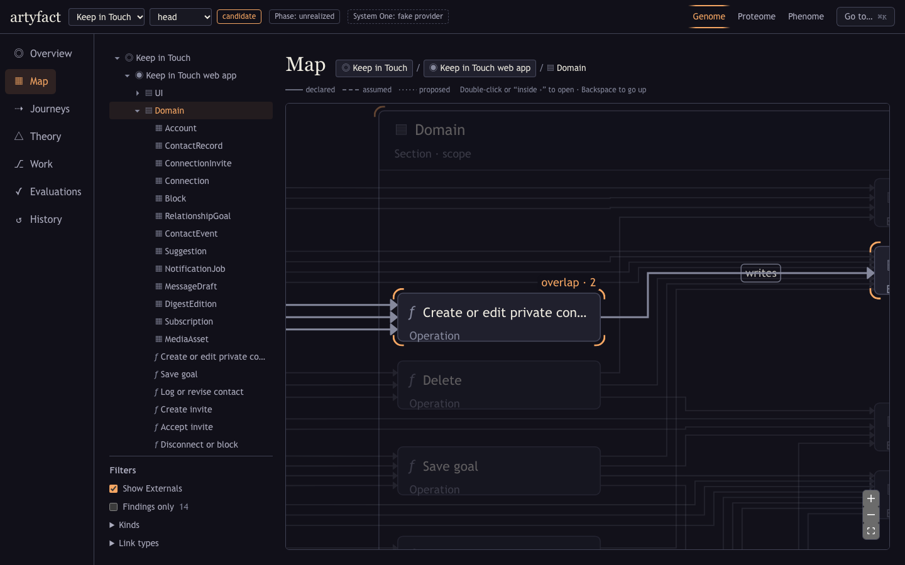
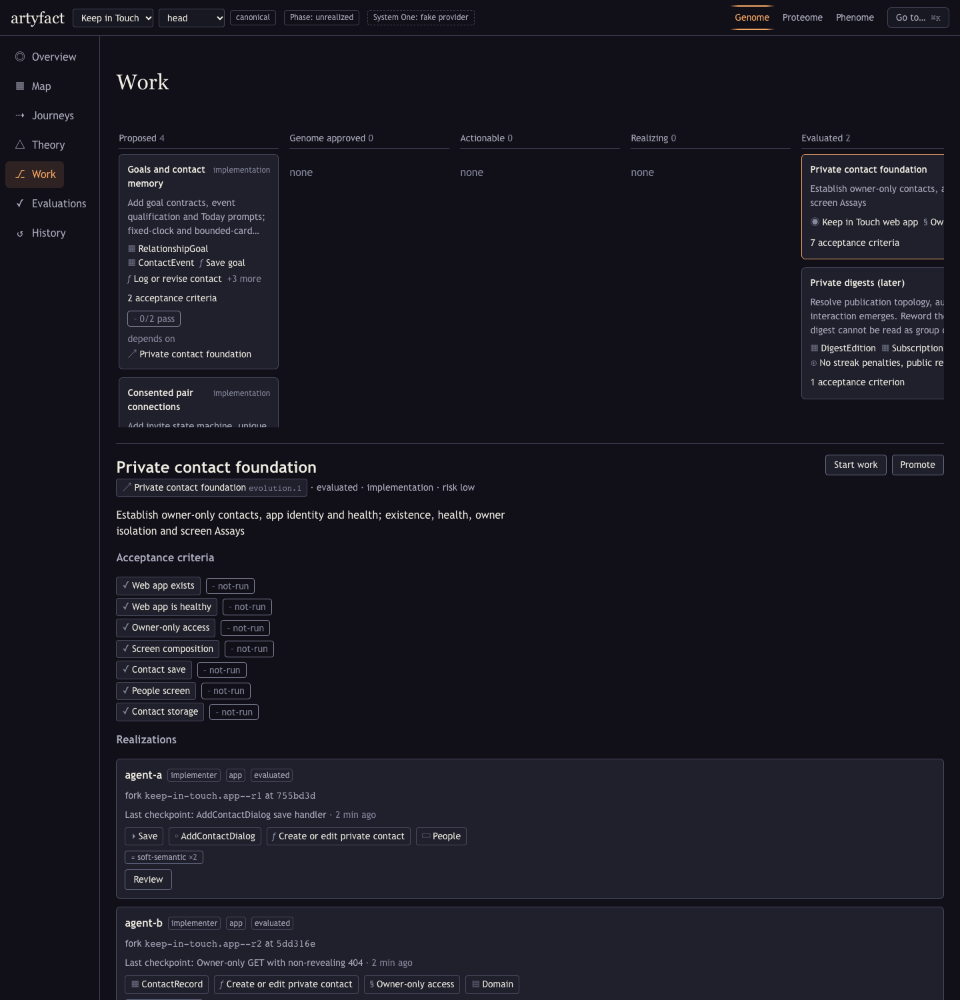
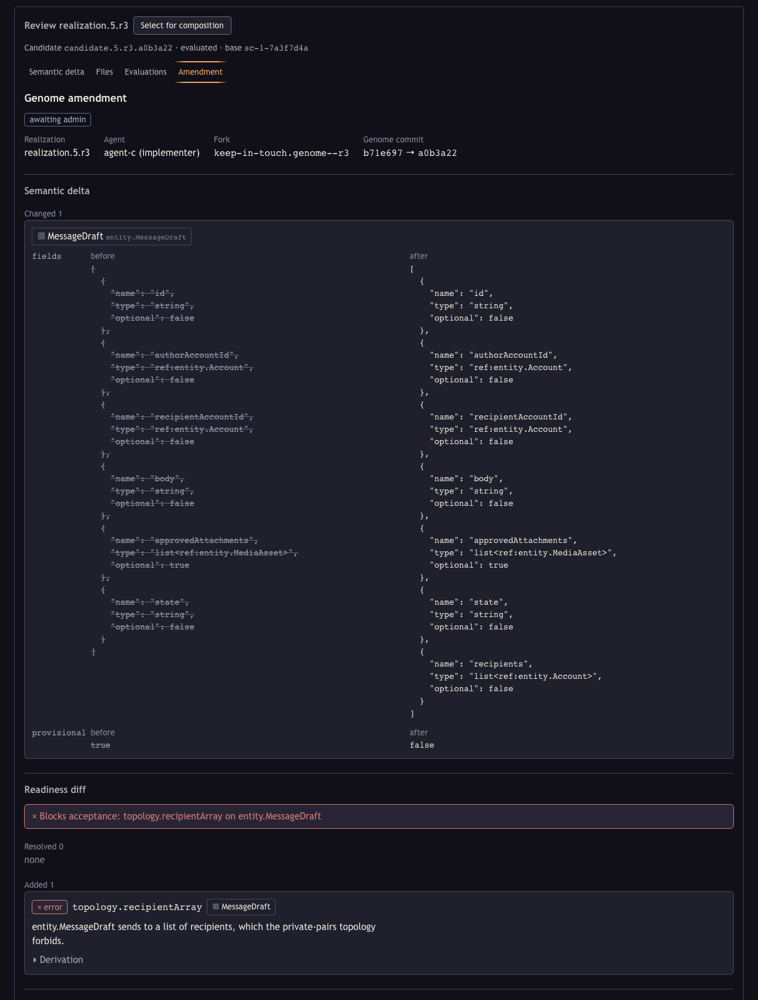
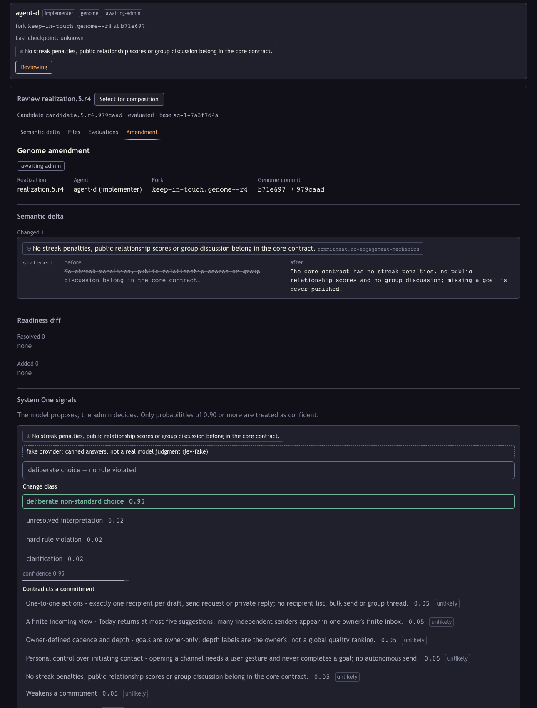
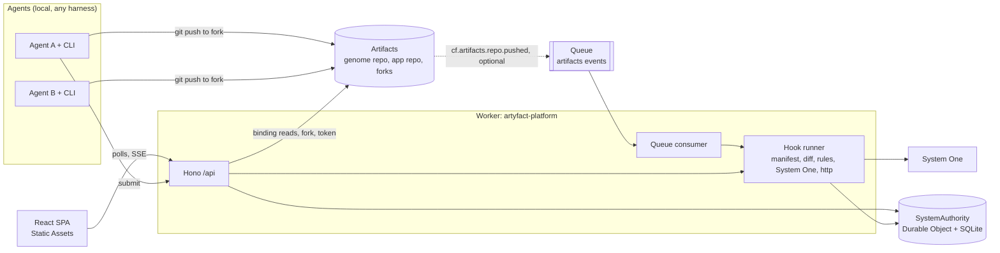

# artyfact

[](LICENSE)

A collaboration platform whose main object is the whole System, not a repository. It runs on Cloudflare Workers and Cloudflare Artifacts. It was built for the Cloudflare "Build the Next-Gen Git Platform" competition.

## Thesis

A file-centred platform can tell you that two agents changed different files. It cannot tell you that their changes disagree about what the product is. artyfact keeps a typed model of the System next to the code. The model is the Genome. It holds the purpose, the screens, the entities, the policies, the journeys and the criteria that say when each part counts as done.

Agents work in a loop. The platform hands an agent a task packet cut from the Genome and a private fork of the repository with a scoped token. The agent pushes. The platform maps the changed files back to Genome nodes, runs the hooks bound to the affected criteria, and compares the new candidate with every other candidate in flight. A person reviews the result and promotes one candidate. Promotion is a compare-and-swap on the System head, so a candidate built on an old head is refused with a 409. Nothing is green without evidence. A verdict is `pass`, `fail`, `unknown`, `stale` or `waived`, and only `pass` is ever drawn in the success colour.

## See it in 90 seconds

Hosted demo: https://artyfact-platform.dawka.workers.dev. Until a System is imported it shows a fixture-mode banner and the bundled example. Deployment steps are in [docs/deploy.md](docs/deploy.md).



The Map with candidates switched on. A bracket halo marks a node a candidate touches. A double bracket and an "overlap" chip mark a node that two candidates share. The layer switch swaps Genome, Proteome and Phenome over the same nodes.



The Work board groups Evolutions by state. Each realization shows its agent, fork, last checkpoint and the nodes its files map to. The soft-semantic chip is the conflict between the two agents. Their files do not overlap.





The amendment review shows the semantic delta, the Readiness findings that were added and resolved, and System One's signals. The first amendment adds a recipient list to a draft and is blocked by a rule. Its screenshot shows the delta and the findings only. The second rewords a commitment and is a deliberate choice, and its screenshot also shows System One's signals. These shots were taken from a local run with the fake System One provider, and the panel labels those judgments, as the second shot shows.

More views: [Map on screen.people, Phenome layer](docs/images/map-screen-people-phenome.png), [Journeys](docs/images/journeys-connect.png), [Theory](docs/images/theory.png), [Overview](docs/images/overview.png).

## Features

- **Home.** Every System as a card with signifiers: evolving, pending realization, awaiting review, not built, deployed or behind, observed.
- **Describe a change.** Create an Evolution, start work for an agent and get a task packet, or edit files in the browser and commit them to a fork over Git. Either way the result is a candidate with its gates.
- **Intent edits.** Describe a change in words. The ontology engine routes the message through the Genome tree, proposes node updates, and you accept the ones you want as a candidate.
- **Code.** Browse the Genome and the app at any revision, edit on head, commit under an Evolution.
- **Changelog and Compare.** One row per System commit with its semantic delta, files, criteria, builds and deployment. Compare any two revisions at System, Genome or file level.
- **Builds and deployments.** A new app candidate gets a preview build, so the health assay checks the deployed app. A promotion asks for a production deployment.
- **Deployments page and the Phenome.** Runtime events from a deployed app, grouped by version and linked to the System commit it runs.
- **Fake platform.** `FAKE_ARTIFACTS=1` runs the whole backend with no account, and the Playwright `@fake` specs drive the use cases through it for both Peopling and Artyfact itself.

## How Cloudflare is used

One Worker serves everything. Static Assets serve the React single-page app. A Hono app handles `/api/*`, and the Worker also exports the queue handler and the Durable Object class.

**Artifacts.** The Genome and the app live in Artifacts repositories in one namespace, next to a shared `platform` repository of templates and Rule Packs. The Worker reads them through the `ARTIFACTS` binding: it reads commits and trees, walks them, and loads the Genome at an exact commit. No Git library runs in the Worker. Starting a realization forks the app repository (or the Genome repository for an amendment), waits for the fork to be ready, and issues a write token that expires after six hours. The token and a per-realization secret are returned once, in the response to the start-work call. Agents clone and push with ordinary Git over HTTPS.

**Submission and push events on Queues.** The primary path is the CLI `submit` command, which pushes to the fork and then calls the API with the commit. The Worker also has a Queue consumer for Artifacts push events (`cf.artifacts.repo.pushed`). It resolves the fork to its realization and submits the new head. Artifacts emits push events only for a repository-level subscription, and this version does not create one per fork automatically, so the consumer is wired and tested but is a deployed-only convenience. Both paths are idempotent on realization and commit, and a redelivered event does nothing.

**Durable Object with SQLite.** `SystemAuthority` is one Durable Object per System. It stores the head, System commits, Evolutions, realizations, candidates, evaluations and seen events. `promote` runs in one synchronous transaction. It reads the head, compares it with the caller's expected head, checks the promotion gate, writes a new System commit with a hashed manifest, moves the head and rejects sibling candidates. Promotion changes the manifest, not Git history.

**Storage.** The System's state lives in two places: the Artifacts repositories and the Durable Object's SQLite. Evaluations and their observations are stored in the Durable Object.

**System One.** Semantic judgments, such as classifying a Genome change, go to System One through TypeSafe, or through OpenRouter if only that key is set. The key is a Worker secret. Without a provider every judgment is `unknown`. See the run notes for `FAKE_S1`.

The longer version, with a diagram, is in [docs/architecture.md](docs/architecture.md).

## Architecture



## What is deterministic and what is model-judged

The Genome is loaded and validated by a Datalog engine running versioned Rule Packs. The same Genome and the same packs give the same findings, and each finding carries its derivation. File mapping, scope checks, existence checks, overlap detection and the promotion gate are plain code.

System One is asked only questions that need judgment: is a change a deliberate non-standard choice or a violation, does an edit contradict a stated commitment, would two changes interfere. Its answers are probabilities. At 0.9 or above they count as confident, between 0.5 and 0.9 they are labelled "review", and low confidence never produces a pass. The admin decides. Promotion blocks on hard criteria that have a bound hook, and an Evolution's acceptance criteria are always in the gate pool. Those that are hard and have a bound hook block. A blocking criterion with no completed evaluation is `unknown`, and `unknown` blocks. The exception is an outcome hook that only runs after deployment: its `not-run` row is disregarded.

Without a System One provider (`TYPESAFE_API_KEY` or `OPENROUTER_API_KEY`), set `FAKE_S1=1` or the purpose gate stays `unknown` and promotion stays closed. The UI labels judgments from the fake provider. `.dev.vars.example` sets `FAKE_S1=1`, and it takes precedence over real keys. A local run copied from the example therefore uses the fake provider until you remove that line.

## The model in two paragraphs

A System has a Purpose, a set of Externals (the people, devices and services outside it), one or more Things and a Theory of how the System should produce its outcome. The Genome is the intended model: a General Description, then nested ontologies for the System and each Thing, refined into requirements and criteria. The Proteome is the layer of agents and execution arrangements that realize the Genome. The Phenome is the layer of measurements and evidence. The three are views over the same nodes, so selecting `screen.people` keeps its identity when you switch layers.

Change goes through Evolutions, Realizations and Evaluations. An Evolution is an intended change with affected nodes and acceptance criteria. A Realization is one agent's attempt at it, in a fork, ending in a candidate manifest. A Criterion belongs to an owner and is attached to a subject. An Assay hook binds a criterion to something that can check it. An Evaluation records the question, the method, the observations, the verdict and the limits. Promotion records the selected candidates and the rationale in a System commit. A realization cannot promote a Genome amendment by itself. A Genome amendment needs an admin decision.

## The agent loop

An agent (or its operator) starts work on an Evolution. The platform forks, issues a token and returns a task packet: intent, acceptance criteria, Genome excerpts for the affected nodes, commitments, permitted and protected paths, entry files, commands and the list of concurrent work. The CLI clones the fork, writes the packet and an `AGENTS.md` block, and the agent works, checkpointing as it goes. On submit the platform records a candidate, runs the hooks for the affected criteria, and reports overlap with the other candidates. A person selects a candidate and promotes it, or rejects it.

## The two moments

**Two agents, different files, one conflict.** Agent A edits the add-contact dialog's save handler. Agent B edits the contacts routes. No file is shared. Through the source map (the `files` globs on Genome nodes) both files reach the node `operation.contact.save`, and the platform reports a soft-semantic conflict between the candidates. The overlap is derived from the Genome and the source map, so it does not depend on a model. System One is also asked whether the changes interfere. With the fake provider it answers "low", and the video says so. The reviewer sees the conflict on the Work board and the Map before promotion. Promoting A and then trying B returns 409 `stale-base`, and promoting B on the current head is refused because it was built on the old one.

**A rule violation is not a deliberate choice.** One agent amends the Genome so that a draft message has a list of recipients. The rules engine proves a `topology.recipientArray` violation and shows its derivation. Accepting the amendment returns 409 and the admin rejects it with a reason. A second agent rewords a commitment. No rule fires, the review panel shows System One's signals, and the admin accepts it with an interpretation. The commit records which provider backed the evidence, here `fake`. The fake provider labels both amendments "deliberate choice", including the violating one, and the rules engine and the gate do not rely on it.

The exact commands and output for both are in [docs/demo-runbook.md](docs/demo-runbook.md) (steps 7 to 10).

## Run it locally

No Cloudflare login is needed to try the interface. In fixture mode the SPA uses a bundled copy of the Peopling System and nothing talks to Cloudflare.

```sh
npm install
npm test               # unit tests; the live System One smoke test is skipped without a key
npm run typecheck
npm run e2e            # builds the SPA and runs the Playwright suite
npm run preview:fixture -w @artyfact/platform
```

`npm run e2e` drives a real browser. If Playwright reports a missing browser, run `npx playwright install chromium` once. `npm run e2e:fake -w @artyfact/platform` runs the use-case specs against the whole backend on in-memory Artifacts (`FAKE_ARTIFACTS=1`, port 1339), also without a login.

The real backend needs a login, because the `ARTIFACTS` binding is remote even in development. Run `npx wrangler login` or set `CLOUDFLARE_API_TOKEN`. The same applies to deploying.

```sh
cp apps/platform/.dev.vars.example apps/platform/.dev.vars
npm run dev -w @artyfact/platform   # http://localhost:1337
```

The amendment review has its own fixture page and needs no login:

```sh
npm run dev:amendment -w @artyfact/platform
# http://localhost:5199/amendment-dev.html?scenario=deliberate|hard|review|fake|off|findings
```

Admin routes (import, start work, accept, reject, promote) need `ADMIN_TOKEN`. Read routes are unauthenticated. The preview health probe reaches only `*.workers.dev`, `*.pages.dev`, hosts in `PREVIEW_HOST_ALLOWLIST`, or localhost when `ALLOW_LOCAL_PREVIEW=1`.

**Importing a project.** `npx artyfact init --dir <project>` takes a cloned project from its Genome (`genome/node.yaml`) to an imported System in one command. For the example, `scripts/bootstrap.sh` is a wrapper that runs `init` on `examples/`.

- **Names.** One Artifacts namespace per deployment (`artyfact` by default). The repository names come from the System id: `system.peopling` gives `peopling.genome` and `peopling.app`. Forks are `<repo>--r<N>`. The id must be lower-case, so two ids never share repositories.
- **The `platform` repository.** It holds the Thing and System templates and the Rule Packs. `init` creates it when it is missing or empty, and `npx artyfact platform-sync` is the way to update it. The import records its commit on the System head and on every System commit. Evaluation still uses the packages bundled into the Worker. `platform` is provenance only.
- **Pushes.** `init` checks that Wrangler and `cf` use the same account and prints only its first eight characters. It never rewrites history: it fast-forwards a repository only from the head it last pushed, and `--adopt` commits on top of history it did not push. Secret files (`.dev.vars`, `.env` and their variants, except `*.example`), `node_modules`, `.wrangler` and `dist` are never pushed, even when tracked.
- **Import.** It then calls the import API with `ARTYFACT_ADMIN_TOKEN`. Without the token it prints the `curl` line and exits 0. `--from-template template.thing.<id>@<version>` (for example `template.thing.cloudflare-worker-webapp@1`) seeds a new app from a scaffold named in `platform`.

The CLI finds the platform from `--platform`, then `ARTYFACT_PLATFORM`, then `ARTYFACT_URL`, then a local server on port 1337 to 1346 that identifies as artyfact. If none does it stops with an error and sends no credential. The platform's default local port is 1337, so `http://localhost:1337` is its URL unless you pass another. This is a real run, with the account shortened by `init` itself. The first call stopped on history it did not push. `--adopt` fast-forwarded over it. The run predates the 1337 default, so its last line was edited from the old port:

```text
$ ./scripts/bootstrap.sh
system.peopling -> peopling.genome, peopling.app (namespace artyfact)
account 1bae12d5… (wrangler and cf agree)
namespace artyfact: exists
  created repo platform
platform: created at 6bd3603921dc
artyfact: peopling.genome has commits this checkout did not push (head ffb68c7) and its tree differs from …/examples/peopling-system.
init never builds over unknown history: merge that history into your project first, or re-run with --adopt to commit your project on top of ffb68c7 (a fast-forward).

$ ./scripts/bootstrap.sh --adopt
system.peopling -> peopling.genome, peopling.app (namespace artyfact)
account 1bae12d5… (wrangler and cf agree)
namespace artyfact: exists
platform: unchanged at 6bd3603921dc
peopling.genome: pushed at 18374568e231
peopling.app: unchanged at c945510ffdf5
imported system.peopling at sc-1-b11cb27a
System: http://localhost:1337/s/system.peopling/r/head/overview
```

A re-run pushes nothing and re-imports as a no-op. Flags and details: [packages/cli/README.md](packages/cli/README.md). Step 2 of the runbook has the same transcript and a later run.

The full loop against real Artifacts, with two agents, a conflict, a promotion and two Genome amendments, is in [docs/demo-runbook.md](docs/demo-runbook.md). It needs a Cloudflare login and an `ADMIN_TOKEN`. Hosted deployment: [docs/deploy.md](docs/deploy.md).

## Artyfact describes itself

The repo-root `genome/` is Artyfact's own Genome (`system.artyfact`, on the dev-platform template): ten Things (platform, ci, site, model, ontology, semantic, rules, templates, cli and effects), with their real endpoints, commands, Durable Objects, Workflow and bindings, `dependsOn` links that match the workspace dependencies, and node `files` that cover every source file outside `.artyfactignore`. `packages/templates/test/self-genome.test.ts` checks all of that. To browse it on the fake platform, with no login:

```sh
cd apps/platform
FAKE_ARTIFACTS=1 FAKE_SEED=artyfact npx vite --port 1337   # FAKE_SEED=both imports Peopling too
```

## Phenome event header

A deployed app reports what it observes with `POST /api/systems/:id/phenome/events` and `{"events": [...]}` (up to 100 per request, 8 KB each). The bearer is the deployment's ingest token, a realization secret for a preview, or the admin token. Every event carries this header; `payload` is free-form JSON.

| Field | Meaning |
|---|---|
| `systemId`, `thingId`, `artifactId` | Which System, Thing and Artifact emitted the event |
| `buildId` | The app's `BUILD_ID`, which is its commit |
| `commit` | The app commit, 7 to 64 hex characters |
| `systemCommit` | The System commit the app was built for (optional) |
| `deploymentId` | The deployment that reported it (optional) |
| `emittedAt` | ISO 8601 time with offset |
| `kind` | Dotted event kind such as `journey.step` or `criterion.observed` |
| `subject`, `criterion` | A Genome node and a criterion the event is about (optional) |
| `id` | Emitter-chosen id; a repeated id is dropped (optional) |
| `payload` | Any JSON |

The platform stamps `seq`, `receivedAt` and the realization. The Deployments page groups events by `buildId`, else `commit`. The schema is `PhenomeEventHeader` in `packages/model/src/phenome.ts`.

## Repository layout

| Path | What it holds |
|---|---|
| `packages/model` | Schemas, loader, validation, diff, overlap |
| `packages/rules` | Datalog engine with derivation trees |
| `packages/templates` | System and Thing templates, Rule Packs |
| `packages/semantic` | System One client, question catalog, policy |
| `packages/cli` | The `artyfact` command for agents |
| `apps/platform` | The Worker, the Durable Object and the SPA |
| `genome` | Artyfact's own Genome (node tree) |
| `examples/peopling-system` | The worked example Genome |
| `examples/peopling-app` | The example app that agents change |
| `docs/design` | Design notes for each part |
| `docs/costs.md` | Cloudflare cost plan, usage checks and guardrails |

## Not done on purpose

- The Ascent and WASM evaluator.
- Reasoning-model hooks beyond System One.
- Paid runs.
- A Git-parity suite. Artifacts is used for what a Git platform needs here, and nothing more is claimed.
- Platform-hosted agents. Agents run on the user's machine.
- Replay of server-sent events after a disconnect. The UI polls and refetches on reconnect.
- Composing more than one app candidate or Genome candidate in one promotion. The API returns `invalid-state`.
- Authentication beyond one admin bearer token and per-realization secrets. Start work needs the admin bearer. Checkpoint, submit, sync, status and packet need the per-realization secret returned once by start work, or the admin bearer. The platform keeps only the secret's hash, and rejecting a realization revokes it. There are no user accounts.

## Licence

Apache-2.0. See [LICENSE](LICENSE) and [THIRD_PARTY_NOTICES.md](THIRD_PARTY_NOTICES.md).
