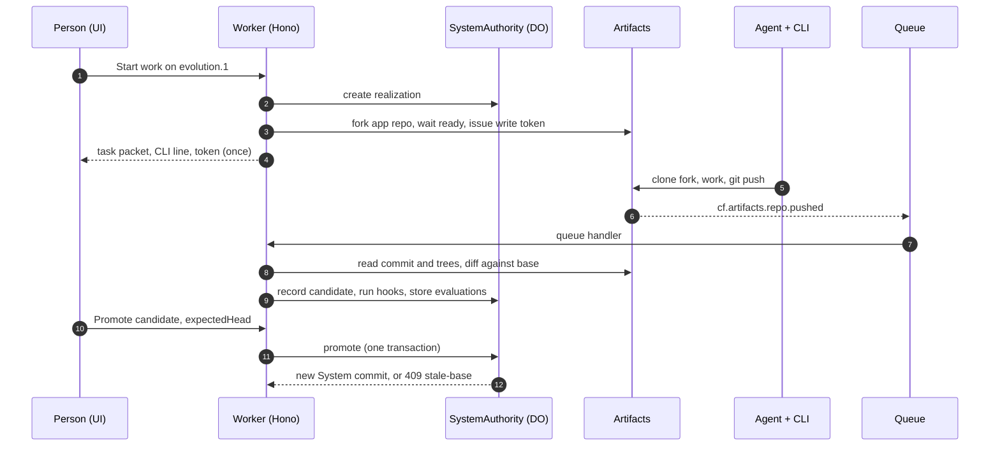

# Architecture

artyfact is one Cloudflare Worker with Static Assets, one Durable Object class, a Queue consumer and a binding to Artifacts. This page follows one change from start to promotion. Wire-level detail is in [design/backend.md](design/backend.md).

## Pieces

**Static Assets and the Worker.** `run_worker_first` is set for `/api/*` only. Every other path serves the single-page app. The SPA polls the API and also listens to `/api/systems/:id/events` over server-sent events. Events are not replayed, so the SPA refetches on every connect.

**Artifacts.** Two repositories hold the example System: the Genome and the app. A realization forks one of them. Reads go through the binding: read a commit, read its tree, read files, and compare tree entry hashes to find changed paths. A `source-map.yaml` in the app maps paths to Genome nodes. A path with no mapping becomes `unmapped:<path>` and its verdict is `unknown`, never a guess.

**Hooks.** Each Criterion lists hooks, and each hook names an engine: manifest, diff, model-rules, system-one or http. A submission runs the hooks of the Evolution's acceptance criteria, of criteria whose subject is a changed node, and of System criteria gated on submission. A hook the platform cannot run comes back `not-run` with verdict `unknown`. The http health hook only fetches preview hosts on the allowlist, does not follow redirects and does not echo response bodies.

**Overlap.** After each submission the platform compares the candidate with the others in flight. It reports three kinds of conflict: file, soft-semantic and hard-semantic. Soft-semantic means the candidates touch nodes that share a journey, policy or outcome hypothesis even though no file is shared. The Promotion panel treats file and hard-semantic conflicts among selected candidates as blocking and soft-semantic conflicts as advisories that need a rationale. The server enforces the same rule through the overlap hook's verdict on the gate: hard-semantic gives `fail`, file or soft gives `unknown`, none gives `pass`. That verdict blocks only if its criterion is in the blocking set.

**Promotion gate.** The blocking set is the Evolution's acceptance criteria plus criteria gated on promotion, limited to hard criteria with at least one bound hook. Each blocking criterion needs a completed `pass` for this exact candidate. If the gate cannot be computed it fails closed with 409 `gate-unavailable`. Hooks run again with fresh facts just before the swap: the base is still current, the manifest binds exactly the promoted commits, and the evidence is fresh.

**Compare-and-swap.** `SystemAuthority.promote` runs inside one synchronous transaction. It reads the head and compares it with `expectedHead`. A mismatch throws and the API returns 409 `stale-base` with the current head. On success it writes a System commit whose manifest is hashed canonical JSON, moves the head, marks sibling candidates rejected and marks the Evolution promoted.

**Genome amendments.** An agent can target the Genome repository instead of the app. The platform loads the amended Genome, runs the Rule Packs, diffs the Readiness findings, and asks System One to review each changed node. The admin accepts or rejects. Accepting records the fork commit as the new Genome commit and the review panel requires an interpretation, which is stored with the decision.

**Secrets and auth.** `ADMIN_TOKEN` guards import, accept, reject and promote. Fork tokens are scoped to one fork and returned only when work starts. The CLI reads the token from an environment variable and never writes it to disk.

## Data

| Store | Holds | Loss means |
|---|---|---|
| Artifacts | Genome and app source, forks | The System is gone |
| Durable Object SQLite | Head, System commits, candidates, evaluations and observations | Review history is gone |
